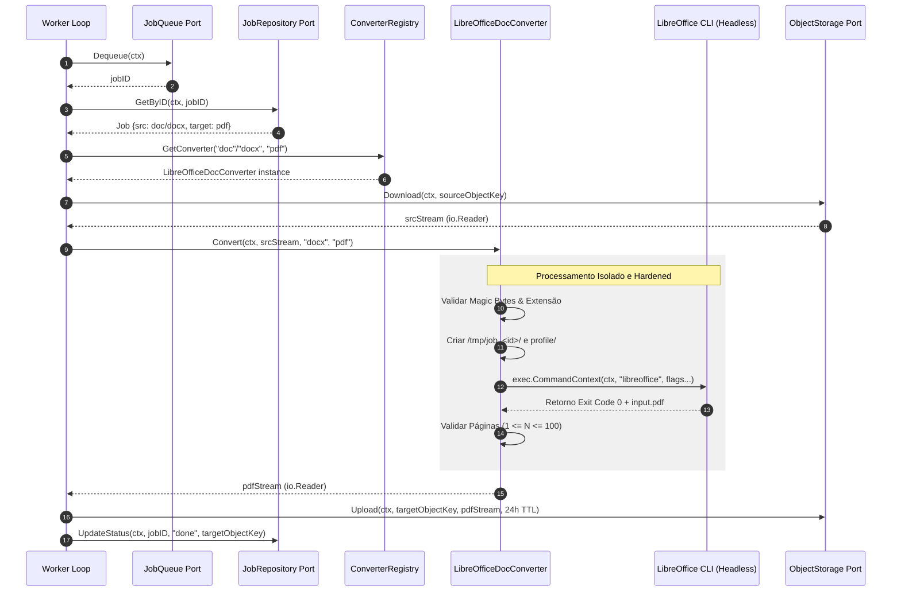

# Desenho de Arquitetura e Design Técnico — Conversão de Documento para PDF (.doc/.docx → .pdf)

## 1. Visão Geral e Arquitetura Hexagonal

Este documento especifica o desenho técnico de arquitetura para o adaptador de conversão de **Documentos de Texto para PDF (`.doc` e `.docx` → `.pdf`)** na **FileConvert API**.

Em estrito alinhamento com os princípios de **Arquitetura Hexagonal (Ports & Adapters)** definidos em [docs/architecture/ports.md](file:///Users/digopaiva/Documents/projects/file-convert-api/docs/architecture/ports.md), a estratégia de execução do LibreOffice em [ADR 0003](file:///Users/digopaiva/Documents/projects/file-convert-api/docs/architecture/adr/0003-document-pdf-conversion-libreoffice-headless-subprocess.md) e o plano de hardening de subprocessos em [ADR 0005](file:///Users/digopaiva/Documents/projects/file-convert-api/docs/architecture/adr/0005-isolamento-subprocesso-conversao.md):
- A lógica de renderização de documentos é totalmente isolada do domínio da aplicação.
- O núcleo da aplicação consome a interface padrão `port.Converter` e resolve a implementação em runtime via `port.ConverterRegistry`.
- O novo adaptador `LibreOfficeDocConverter` será implementado no pacote `internal/adapters/converter/document` (ou `internal/adapters/converter`).

---

## 2. Diagrama de Componentes e Fluxo de Execução



---

## 3. Contrato de Execução e Hardening do Subprocesso LibreOffice

O adaptador `LibreOfficeDocConverter` executa o binário do LibreOffice via `os/exec.CommandContext`. A invocação segue rigorosamente as diretrizes de isolamento de infraestrutura estabelecidas no **ADR 0003** e no **ADR 0005**.

### 3.1. Comando CLI Exato e Flags Obrigatórias

```bash
libreoffice \
  --headless \
  --norestore \
  --nodefault \
  --nofirststartwizard \
  --nolockcheck \
  --nologo \
  -env:UserInstallation=file:///tmp/job_<job_id>/profile \
  --convert-to pdf \
  --outdir /tmp/job_<job_id>/ \
  /tmp/job_<job_id>/input.<srcFormat>
```

### 3.2. Detalhamento e Justificativa das Flags de Execução

| Flag | Finalidade Técnica & Hardening | Risco Mitigado / Benefício |
| :--- | :--- | :--- |
| `-env:UserInstallation=file:///tmp/job_<job_id>/profile` | **CRÍTICO.** Isola o perfil de usuário do LibreOffice exclusivamente no diretório temporário do job (`tmpfs`). | **Concorrência & Race Conditions:** Impede contenção de locks de arquivo de configuração em execuções concorrentes de múltiplos workers. **Segurança:** Garante perfil virgem sem vazamento de estado inter-jobs. |
| `--headless` | Execução pura em modo CLI, desativando dependências de display gráfico (X11 / GUI). | Reduz consumo de memória e evita falhas por ausência de servidor X. |
| `--norestore` | Desativa diálogos de recuperação de documentos travados em sessões anteriores. | Impede que o processo trave indefinidamente aguardando interação em caso de crash anterior. |
| `--nodefault` | Impede o carregamento do documento padrão inicial do LibreOffice. | Acelera a inicialização (*startup time*). |
| `--nofirststartwizard` | Desativa o assistente de primeira execução. | Elimina sobrecarga e bloqueios de navegação interativa. |
| `--nolockcheck` | Ignora verificações de lock de arquivo no diretório temporário. | Evita falhas de I/O em arquivos récem-criados no `tmpfs`. |
| `--nologo` | Desativa a exibição da tela de abertura (splash screen). | Otimiza o tempo de inicialização. |
| `--convert-to pdf` | Especifica o filtro nativo de exportação direta para o formato PDF. | Garante a utilização do motor de layout nativo do LibreOffice Writer. |

---

### 3.3. Tratamento e Desativação de Macros (VBA / Scripting)

Conforme especificado em [docs/specs/documento-pdf-conversao/requirements.md](file:///Users/digopaiva/Documents/projects/file-convert-api/docs/specs/documento-pdf-conversao/requirements.md):

- **Comportamento:** Documentos `.doc` ou `.docx` contendo macros (código VBA) **não são rejeitados**, mas têm a execução de suas macros **completamente desativada**, gerando o PDF estático correspondente às páginas do documento.
- **Mecanismo de Proteção:**
  1. A execução com `-env:UserInstallation` virgem e a flag `--norestore` em modo `--headless` impede a inicialização de manipuladores de scripts de macros interativas.
  2. **Defesa em Profundidade (ADR 0005):** O container do worker executa sob o usuário não-root `appuser`, sem capacidades do Linux (`--cap-drop=ALL`), com prevenção de escalada (`no-new-privileges:true`), com o sistema de arquivos raiz em somente leitura (`read_only: true`) e **totalmente sem acesso à rede** (`--network=none`). Mesmo que uma macro maliciosa tentasse ser avaliada, seria incapaz de realizar chamadas de rede *Command & Control* (C2) ou efetuar gravações no sistema.

---

## 4. Especificação Técnica do Adaptador (`LibreOfficeDocConverter`)

- **Pacote:** `internal/adapters/converter/document` (ou `internal/adapters/converter`)
- **Arquivo:** `doc_to_pdf.go`
- **Interface Implementada:** `port.Converter`

### 4.1. Método `CanConvert(srcFormat, targetFormat domain.Format) bool`

```go
func (c *LibreOfficeDocConverter) CanConvert(srcFormat, targetFormat domain.Format) bool {
    isSrcValid := srcFormat == domain.FormatDOC || srcFormat == domain.FormatDOCX
    isTargetValid := targetFormat == domain.FormatPDF
    return isSrcValid && isTargetValid
}
```

### 4.2. Método `Convert(ctx context.Context, src io.Reader, srcFormat, targetFormat domain.Format) (io.Reader, error)`

1. **Validação de Entrada:**
   - Verifica os magic bytes de entrada via `domain.ValidateMagicBytes(src, srcFormat)`.
   - Se os magic bytes forem incompatíveis, retorna `domain.ErrCorruptedFile`.
2. **Criação de Sandbox Temporário por Job:**
   - Cria o diretório de trabalho `/tmp/job_<job_id>/` e a pasta de perfil `/tmp/job_<job_id>/profile/`.
   - Assegura a purga de todo o diretório ao término via `defer os.RemoveAll(tmpDir)`.
3. **Escrita do Arquivo de Entrada:**
   - Grava o payload do `src` no arquivo `/tmp/job_<job_id>/input.<srcFormat>`.
4. **Execução do Subprocesso com Timeout de 90 Segundos:**
   - Cria um contexto filho com o timeout de 90s do conversor: `ctxTimeout, cancel := context.WithTimeout(ctx, 90*time.Second)`.
   - Invocação do `exec.CommandContext(ctxTimeout, "libreoffice", args...)`.
5. **Inspeção de Saída e Mapeamento de Erros:**
   - Verifica o código de retorno do subprocesso.
   - Em caso de falha, mapeia os logs de stdout/stderr para erros tipados de domínio (`domain.ErrPasswordProtectedDocument`, `domain.ErrCorruptedFile`).
   - Se o contexto expirar (timeout de 90s), retorna `domain.ErrJobTimeout`.
6. **Validação de Páginas e Formato Gerado:**
   - Verifica a existência e tamanho do arquivo PDF gerado `/tmp/job_<job_id>/input.pdf`.
   - Utiliza leitor de cabeçalho PDF / contagem de páginas para validar que $1 \le N \le 100$.
   - Se $N == 0$, retorna `domain.ErrEmptyDocumentPages`.
   - Se $N > 100$, retorna `domain.ErrPageLimitExceeded`.
7. **Retorno do Stream:**
   - Abre o arquivo PDF gerado em memória ou stream bufferizado e retorna como `io.Reader`.

---

## 5. Mapeamento de Erros de Subprocesso para o Domínio

O adaptador intercepta as saídas do binário `libreoffice` e as mapeia para erros tipados definidos em `domain`:

```go
func mapLibreOfficeError(output string, err error) error {
    outLower := strings.ToLower(output)
    if strings.Contains(outLower, "password") || strings.Contains(outLower, "encrypted") || strings.Contains(outLower, "passphrase") {
        return domain.ErrPasswordProtectedDocument
    }
    if strings.Contains(outLower, "corrupt") || strings.Contains(outLower, "read error") || strings.Contains(outLower, "format error") {
        return domain.ErrCorruptedFile
    }
    return fmt.Errorf("%w: libreoffice exit status error - %s", domain.ErrCorruptedFile, output)
}
```

---

## 6. Garantias de Recursos e Limites de Execução

1. **Timeout Específico:** Operação vinculada ao contexto de 90 segundos (`90s`), acomodando o tempo de inicialização do runtime do LibreOffice e a renderização de documentos complexos.
2. **Limite de Páginas:** Teto máximo de **100 páginas** por documento para evitar estouro de memória e estagnação da fila.
3. **Limpeza Garantida:** Todo diretório temporário em `/tmp/job_<id>` é sumariamente removido após a conclusão do job (seja com sucesso ou falha).
